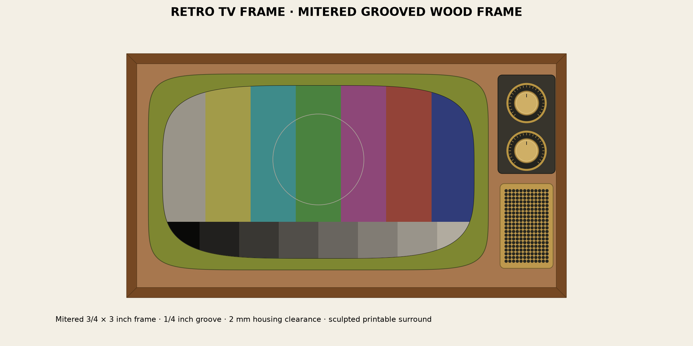

# Retro TV Frame

**[Open the live interactive preview](https://thatoneguydavid.github.io/retro-tv-frame/design/assembly/assembly-viewer.html)** — rotate the assembly, explore the layer tree, and zoom in on the parts.

**Work in progress — shared before final assembly.** The current printable bezel is **v8**, with a flat inner printing land. Its test print was reported successful on **2026-11-10**. Display fit, bonding, woodworking and final assembly checks are still underway. Dimensions and instructions may change as the build progresses. The images below are CAD views, not finished-build photographs.

A modern flat display dressed as a 1960s–1970s television: sculpted olive-green surround, brass-finished controls, a perforated speaker grille, and a mitered wooden cabinet frame.



*CAD illustration of the supplied design, not a photograph of a completed build.*

The viewer's **Retro test pattern** switch controls a decorative color test card on the viewing glass. It is a presentation effect, not printed geometry or a calibrated display test signal.

The printable parts, woodworking template, assembly model, and editable geometry source are all included. The example is specified by measurements, with no display brand or model required. Use the supplied parts for a matching display envelope, or adapt the design to your own measurements.

## What makes it work

- **Continuous curved surround:** the green bezel rises from a 1 mm gap beneath its inner lip to a 30 mm outer peak, clearing the raised factory frame without a shelf interrupting the curve.
- **Two printable halves:** broad hidden joining keys bridge the seams. The rear joint features stay at least 7 mm from the inner opening.
- **Built-in fitting features:** twelve glue feet establish the installed height; eight tapered locating tabs register against the factory frame's inside walls and keep the print off the glass.
- **Paintable modular knobs:** each control has a black dial, separate brass trim, fluted grip, paint-filled index cap, and removable hub. The hub is left blank so the visible knob does not dictate the eventual shaft hardware.
- **Single-piece grille:** circular perforations, a solid border, and top/bottom mounting bands keep the control column compact.
- **Real woodworking geometry:** four mitered 3/4 × 3 inch rails capture the thin faceplate in a 1/4-inch-deep groove, with clearance around the display and the printed parts.
- **Ordinary paper template:** ten US Letter tiles, alignment crosses, overlapping edges, and a ruler-check page. The template shows only the faceplate and its cutouts.

## Start here

1. Compare your display with the [measurement table](docs/dimensions.md). These are fitted parts, not a universal clip-on shell.
2. Read the [parts list and build guide](docs/build-guide.md), then print the small fit samples before the large halves.
3. [Open the live assembly viewer](https://thatoneguydavid.github.io/retro-tv-frame/design/assembly/assembly-viewer.html) in your browser. For offline use, download the repository and open [assembly-viewer.html](design/assembly/assembly-viewer.html) locally. Rotate it and hide components to inspect the mounting surfaces. All controls are in the left sidebar; use the zoom slider or mouse wheel, and Fit view to reset framing.

   The layer tree lets you toggle the whole assembly, green bezel/joints, right-hand section, controls, either complete knob, wooden frame, or individual pieces. Expand a group for its children; a mixed checkbox means only some are visible.
4. Print the [faceplate-only PDF](design/faceplate/faceplate-letter-tiled.pdf) at **Actual Size / 100%**. Measure its scale marks before cutting wood.
5. For another display, follow [adaptation and prompt suggestions](docs/adapting.md).

## Files to make the supplied design

| Item | Quantity | Files |
| --- | ---: | --- |
| Green bezel v8 | One left, one right | [Left](design/bezel/bezel-left.stl), [right](design/bezel/bezel-right.stl) |
| Rear joining keys | 2 | [Key](design/bezel/joining-key.stl) |
| Knobs | Two sets of five parts | [Knob parts](docs/build-guide.md#knobs) |
| Knob mounting plate | 1 | [Plate](design/assembly/knob-mounting-plate.stl) |
| Speaker grille | 1 | [Grille](design/grille/speaker-grille.stl) |
| Wooden faceplate | 1 | [Letter PDF](design/faceplate/faceplate-letter-tiled.pdf), [full-size SVG](design/faceplate/faceplate-full-size.svg) |
| Wooden frame | Four mitered rails | [Cut list](design/assembly/frame-cut-list.csv), [section drawing](design/assembly/frame-section.png) |

The files in `design/bezel/` are the current **bezel v8** geometry; filenames stay stable so links remain useful. Use these files rather than any older local bezel exports.

STLs use **millimeters**. The bezel halves are mirror images; print one of each. Their inner rims have a flat printing land at **Z=0**, 2.2 mm wide at the top/bottom and 2.7 mm at the sides, blended into the underside. Files named `assembled` or `reference`, the frame STLs, and the GLB are inspection models rather than print layouts.

Each bezel half is **340.5 × 384 × 29 mm**, before supports or brim. The design was laid out for a 420 mm-square printer bed. Check the complete sliced footprint, not just the model bounds.

## Size and scope

The reference display has a **596.9 × 336.55 mm** viewing area, a **662.9 × 418.55 × 44 mm** square-edged body, and a viewing surface recessed **7 mm** from its factory bezel. The faceplate is **803.2 × 434.75 mm**; the wooden frame is **829.1 × 460.65 mm** outside.

The project supplies the decorative front, fit features, frame geometry, and fabrication files. The reference display is one intact unit. Its original stand can remain in use, but its actual stand, ports, ventilation, and a structural attachment for the added frame are not designed here. The grille is not a speaker enclosure or speaker mount. The knobs accept future custom shaft adapters; there is no included electronics or rotary-control integration.

See [build-guide.md](docs/build-guide.md) for assembly and finishing, [features.md](docs/features.md) for the fitting details, and [dimensions.md](docs/dimensions.md) for the complete coordinate reference.

## Editable source

Python scripts generate the meshes, fit checks, diagrams, offline viewer, cut list, and templates.

```bash
python3 -m venv .venv
# Linux/macOS:
source .venv/bin/activate
# Windows PowerShell instead: .venv\Scripts\Activate.ps1
python -m pip install -r requirements.txt
python tools/build.py
python tools/verify.py
```

The supplied dependency set was exercised with Python 3.14. Building can take several minutes and rewrites generated files in `design/`. No cloud account, AI service, or API key is needed to use or rebuild the files. See [source and verification](docs/source.md).

## License

[MIT](LICENSE). You are welcome to use, modify, and share the files under its terms. If you build a version, photographs and measurements of your adaptations are useful contributions.
