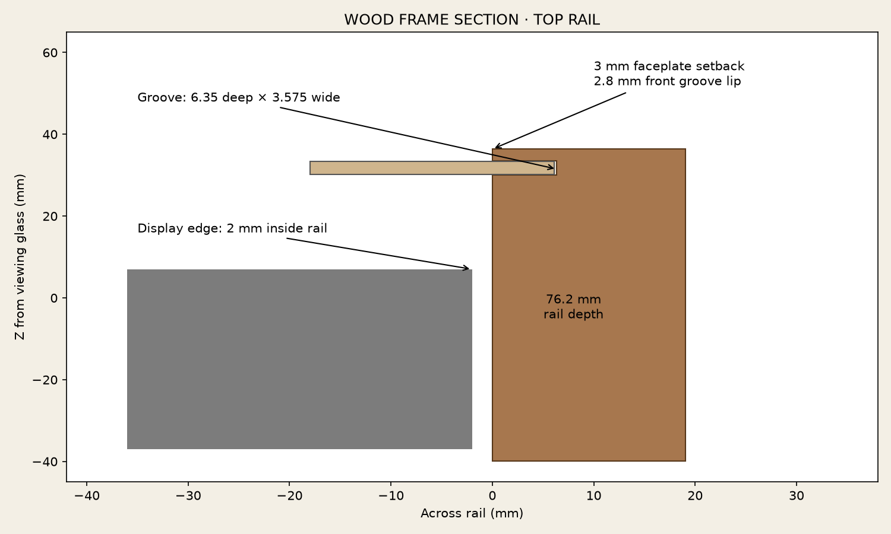

# Build guide

This guide describes the geometry supplied in this repository. Measure the actual display, stock, faceplate, and printed samples before committing to full prints or final wood cuts. There are no included slicer profiles, adhesive-brand prescriptions, or invented control electronics.

## Materials and tools

- A display matching the [example envelope](dimensions.md), or an adapted set of files.
- Filament appropriate to your finishing process and the temperature around your display; quantity depends on slicing and supports.
- Thin wooden faceplate material, nominal **1/8 inch / 3.175 mm**. The modeled groove includes 0.4 mm total thickness allowance. Match the groove to your actual panel if thinner.
- Four lengths of actual **3/4 × 3 inch / 19.05 × 76.2 mm** stock. Allow extra length for miters, saw kerf, and test cuts.
- Adhesives suitable for the chosen filament, wood, and factory bezel finish; sample-test compatibility and cured bond thickness.
- Primer, filler, sanding supplies, olive-green paint, satin-black paint, brass/gold finish, and contrasting paint for the knob index marks.
- Optional black acoustic cloth behind the grille, held clear of a speaker cone and surround.
- A printer that can accommodate the large halves **with supports**, a slicer, paper printer, ruler, tape, clamps, and woodworking tools for accurate panel cutouts, grooves, and miters.
- If using rotating hardware: actual encoders/potentiometers/switches, hardware-specific shaft adapters, and an independent mounting/support scheme selected for those parts.

The added wood frame needs an appropriate structural mounting solution. The thin panel and glued decorative parts are not a substitute for supporting the monitor or proving the original stand can carry the added assembly.

## 1. Test the fit features

Print these in millimeters at 100% before full parts:

- [Alignment sample](../design/bezel/alignment-fit-test.stl): one locating tab. Hold it at the intended installed height while checking the factory recess wall; it contains no glue foot and cannot set height on its own.
- [Display fit sample](../design/bezel/display-fit-test.stl): inner lip, curved surface, and one glue foot. Check the raised factory edge and intended 1 mm glass gap.
- [Joint sample left](../design/bezel/joint-test-left.stl), [right](../design/bezel/joint-test-right.stl), and one [joining key](../design/bezel/joining-key.stl).
- [Perforation sample](../design/grille/perforation-test.stl) to judge holes, paint buildup, and finish.

The factory display remains intact. Protect the viewing surface. Locating tabs should guide the print into place without forcing it; tips are designed to stay 3 mm above glass. The inner lip's underside has 1 mm clearance. The glue feet land on the raised factory frame, not on the glass.

## 2. Print the bezel and grille

Print one [left half](../design/bezel/bezel-left.stl) and one [right half](../design/bezel/bezel-right.stl), plus two [keys](../design/bezel/joining-key.stl). The large halves have a permanent flat underside land at Z=0 in their print files: 2.2 mm wide at the top/bottom and 2.7 mm at the sides, blended back into the shell. Import a fresh half in its supplied orientation. A previous edge-only contact profile was corrected after a failed print. Check the first sliced layer for a continuous flat contact strip and connected brim; reaching Z=0 alone does not establish adequate bed contact. The assembled bezel STL uses the glass datum and starts at Z=1: do not mistake it for a print layout.

In Anycubic Slicer Next, a starting adhesion setup is Process → Global → Others → Brim: Outer and inner brim, width 10 mm, Brim-object gap 0 mm. Check the sliced first layer to confirm a connected brim along the inner rim; the half is an open shape so boundary naming can be misleading. An actual Anycubic Slicer Next 2.0.0.5 slice of the corrected left half with tree supports generated first-layer brim and bezel toolpaths successfully, without slicing warnings. [First-layer toolpath plot](../design/bezel/first-layer-brim.png) and [slice evidence](../design/bezel/first-layer-check.json) are included. These settings are a starting point, not a verified successful physical print profile.

The curved surfaces, taller glue feet, and locating tabs need support review. Inspect initial layers, support access, removal paths, and the entire tree-support/brim footprint. Leave the locating and glue contact surfaces usable after support removal. Half bounds are 340.5 × 384 mm, leaving only 18 mm per side along the tighter axis of a centered 420 mm bed before support structures.

Print the **100 × 192 × 3 mm** [grille](../design/grille/speaker-grille.stl) flat. Its holes are vertical, with no geometric overhangs in that orientation. Choose the cleaner flat face as the front. The top/bottom mounting bands are hidden by wood; their unused screw slots do not require holes in the faceplate.

Bond the two bezel halves face-aligned, using the shallow rear keys across the top and bottom seams. Nominal key/pocket allowance is 0.2 mm per side, with a 0.1 mm floor adhesive gap. Clamp without distorting the curve, keep the inner edge aligned, and fill/sand the visible seams. No snap joint is intended.

## Knobs

Print **two of each**:

| File | Purpose |
| --- | --- |
| [dial-plate.stl](../design/knobs/dial-plate.stl) | Fixed black dial with recessed scale marks |
| [brass-trim.stl](../design/knobs/brass-trim.stl) | Separate 3.6 mm-wide, 2.4 mm-thick brass-finish ring |
| [fluted-grip.stl](../design/knobs/fluted-grip.stl) | Nominal Ø46 × 18 mm grip with 64 rounded flutes |
| [center-cap.stl](../design/knobs/center-cap.stl) | Shallow conical cap with recessed painted index |
| [blank-hub.stl](../design/knobs/blank-hub.stl) | Replaceable solid-centered rear hub |

Print one [knob mounting plate](../design/assembly/knob-mounting-plate.stl), 108 × 186 × 3 mm. The two Ø76 mm dials sit on it. The stationary dial plates can be glued to the mounting plate, and the mounting plate to the faceplate. Their unused screw holes do not need matching wood holes for this mounting method.

Finish the ring, grip, cap, and dial separately. Keep fits free of heavy paint buildup. Ring has 0.2 mm radial seating clearance at both boundaries; cap/pocket and hub/collar fits each have 0.4 mm diametral clearance. Glue the index cap in the intended angular position after filling its stripe with contrasting paint.

The removable hub joins the grip with two provisional 3 mm self-tapping fasteners into Ø2.6 pilot bores, at X=±13 mm. Hub has Ø3.4 holes and Ø6.4 × 1.8 mm head counterbores. Select head size and screw length for the real print: do not assume any arbitrary M3 screw will fit or form a reliable thread. Do not let screws protrude into moving or visible parts.

**The hub center is blank, not a ready-to-use shaft socket.** Choose and support actual control hardware, then modify/drill a suitable hub for its shaft and retention. The dial does not provide a shaft bearing. The 25-mark scale covers 270° and is not a calibrated control; an endless encoder may call for a different scale. Shaft access is omitted from the clean wood template until actual hardware is selected.

## 3. Make the faceplate

Use the **[clean Letter PDF](../design/faceplate/faceplate-letter-tiled.pdf)**. It contains one calibration page plus ten tiles, 5 across × 2 down. Paper is 8.5 × 11 inch portrait with 1/2 inch margins and 10 mm overlaps.

1. Print the first page at **Actual Size / 100%**, with Fit/Shrink disabled.
2. Measure the 100 mm bar and 1 inch square in both axes.
3. Print the ten tiles with the same settings. Arrange R1 C1–C5 above R2 C1–C5.
4. Trim one shared margin, overlap the drawings, and match labeled crosses and contour lines rather than paper edges alone.
5. Apply to the wood's front, TOP up. Cut the **803.2 × 434.75 mm** outer boundary, curved **640 × 369 mm** screen opening, and **100 × 160 mm R8** speaker opening. Alignment crosses/dotted overlap guides are not cuts.
6. Dry-fit prints and paper against the actual display before cutting final material. The screen opening is a curved contour, not the 640 × 369 bounding rectangle.

The panel extends 6.1 mm into each 6.35 mm groove, leaving 0.25 mm to each groove bottom. It is larger than the visible opening, not the frame's outside size. Do not trim it down to the frame opening.

## 4. Make the wooden frame

Use the [CSV cut list](../design/assembly/frame-cut-list.csv). Dimensions assume actual 19.05 × 76.2 mm stock:

| Rails | Quantity | Long point to long point | Short point to short point |
| --- | ---: | ---: | ---: |
| Top and bottom | 2 | 829.1 mm | 791 mm |
| Left and right | 2 | 460.65 mm | 422.55 mm |

Both ends have 45° miters. The 19.05 mm dimension is the visible front border width; 76.2 mm extends rearward. The model gives an inside opening of 791 × 422.55 mm and outside size 829.1 × 460.65 mm.

Route the inward-facing groove **6.35 mm deep**. The example's width is **3.575 mm** for a 3.175 mm panel. Its front/back edges are **2.8 / 6.375 mm behind the front rail face**, placing the faceplate front 3 mm behind the rail front. This groove location is a design choice: test the 2.8 mm front lip and actual panel fit on scrap before routing full rails. Set groove width from actual material, not only a labeled nominal thickness.

The frame leaves 2 mm around the display at top/bottom. The left display clearance is 11.05 mm because the unchanged green flange must also fit; that flange has 2 mm rail clearance. The right rail clears the control plate by 2 mm. Miter glue-up, reinforcement, cutting allowances and finish are woodworking decisions, not a supplied structural proof.

Dry-assemble the rails around the panel. A rigid panel is captured by the grooves; do not assume it can be inserted into an already closed frame. Consider assembly order before permanent bonds to the monitor. The rails reach 2.825 mm behind the modeled housing rear, but the actual stand, ports, vents, cables and their access are not modeled. Keep them accessible and unobstructed.

## 5. Finish and assemble

Dry-fit the entire assembly before paint. Fill and sand the front bezel seams while preserving the continuous curve. Paint the bezel olive green, the control plate/dials satin black, and grille/trim/grips/caps brass or gold as desired. Keep precision fits and bond surfaces clear of incompatible finish buildup.

Bond the twelve green glue feet to the raised factory bezel. Their designed bottoms sit at Z=7.2 over its Z=7 face, reserving nominal 0.2 mm adhesive. This installed height preserves the 1 mm inner-lip air gap; a thicker or thinner bond changes that gap. Do not glue the inner edge or locating tabs to the glass. Test the actual substrate/filament/finish bond and cured thickness before permanent attachment.

Bond green flange and grille mounting bands behind the faceplate. Bond the knob plate in front. Keep glue out of perforations, shaft passages, and moving parts. Any speaker mounts independently, with clearance behind the grille; the grille is not the speaker support. Complete and check the chosen frame/monitor support solution before loading the original stand with the added wood assembly.
