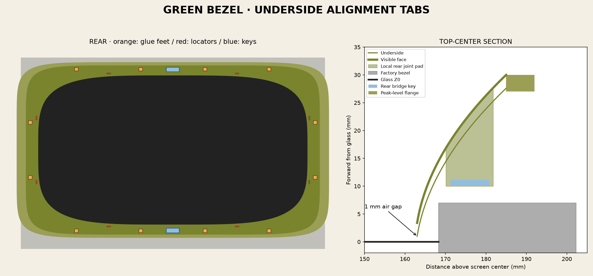

# How the fitting features work

## One uninterrupted curved face

The inner edge follows a rounded superellipse inside the viewing rectangle. The underside is 1 mm above glass, and the top face is 3.4 mm high there. The surface rises continuously to an outer peak of 30 mm. It clears the 7 mm factory step without inserting a shelf into the visible curve. Shell separation is 2.4 mm in Z; this is not a uniform thickness normal to the curved surface.

The wooden opening overlaps the outer sculpted rim by nominal 0.5 mm per straight axis. The flange extends **outward only** and has its wood-contact face level with the peak. There is no inward ledge over the sculpted face and no deep perimeter skirt reaching the bed.

## Two halves and hidden bridge keys

Two left/right halves fit a large printer without a seam down either curved side. A flat key bridges each center seam from behind. Keys are 27.6 × 9.6 × 1 mm, seated in 28 × 10 mm rear-open pockets. Local pads keep the complete joint feature at least 7 mm from the inner opening, exceeding a 6 mm minimum design requirement.

Key seating is Z=10.1–11.1; the floor is Z=11.2. That allows a nominal 0.1 mm adhesive gap and places the key at least 3.1 mm above the raised factory face. The broad keys support alignment and bonding while the visible seam is filled and finished. They do not snap or lock the halves together without adhesive.

## Twelve glue feet set height

There are four feet along the top, four along the bottom, and two on each side. Their 8 × 8 mm footprints lie entirely on the raised factory bezel, not on glass. Tops merge with the curved shell; bottoms share Z=7.2, allowing a nominal 0.2 mm adhesive layer over the factory front at Z=7. This height relationship is what maintains the 1 mm gap under the lip.

Their locations relative to viewing center are X=-210,-70,70,210 at Y=±176.5 for top/bottom, and X=±310.5 at Y=±60 for the sides. Check the footprints against actual flat usable areas; buttons, rounded edges or vents invalidate a simple rectangular assumption.

## Eight locating tabs set lateral position

Two tabs per edge drop into the factory recess and face its inner walls. Top/bottom tabs are at X=±140; side tabs at Y=±70. Each is 8 mm along the wall and 1.8 mm thick radially.

Full registration faces have 0.3 mm nominal clearance from the factory wall, meaning 0.6 mm total positioning play across opposed tabs. Tips end 3 mm above glass and have a 0.6 mm lead-in over the first millimeter of height. They guide placement without a press fit. They are not glue pads and do not set vertical position. This distinction matters: forcing them against a wall or glass can defeat the intended air gap.

## Modular controls and compact grille

The black control plate mounts the two circular dials; rings and caps are separate for finishing. Painted grooves replace a tiny loose pointer, and a wide trim ring gives a manageable printable part. Removable blank hubs let the visible controls stay the same when shaft hardware changes.

The grille's 240 Ø4.8 mm holes have 2.2 mm webs on a 7 mm pitch. Its 27.2% visible open area is a geometric figure, not an acoustic rating. Top/bottom mounting bands leave the sides narrow, allowing a 2 mm clearance between the complete grille and green flange envelopes. A speaker and enclosure need their own design behind it.

## Captured wooden faceplate

The four rearward-extending rails carry a 6.35 mm-deep groove. The panel engages 6.1 mm, leaving 0.25 mm per edge at groove bottoms. The 803.2 × 434.75 mm panel is intentionally larger than the frame's 791 × 422.55 mm visible opening. Clearances are checked around both the display and hidden plastic; sizing only to the visible glass would make the rearward rails collide with the housing or flange.
